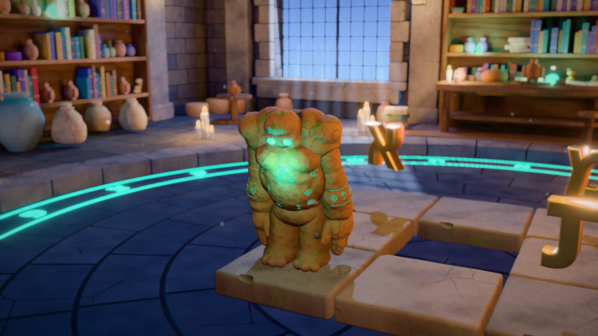
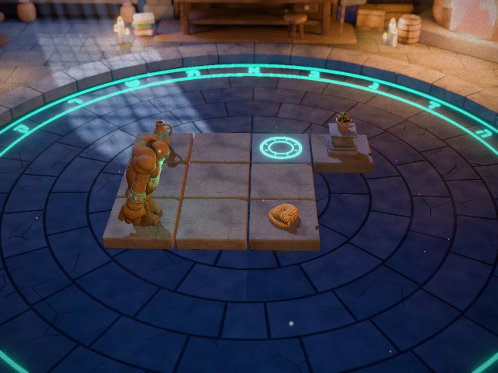
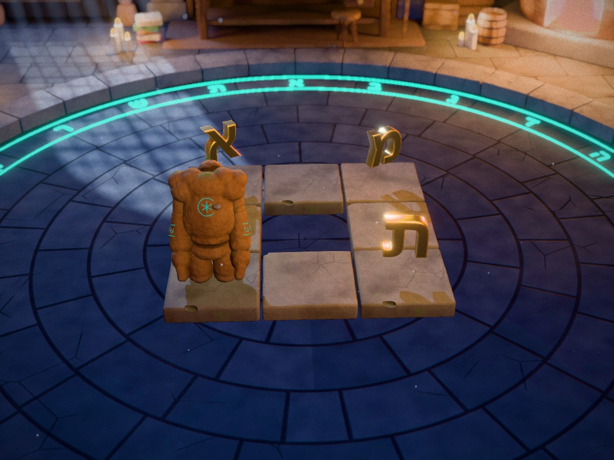
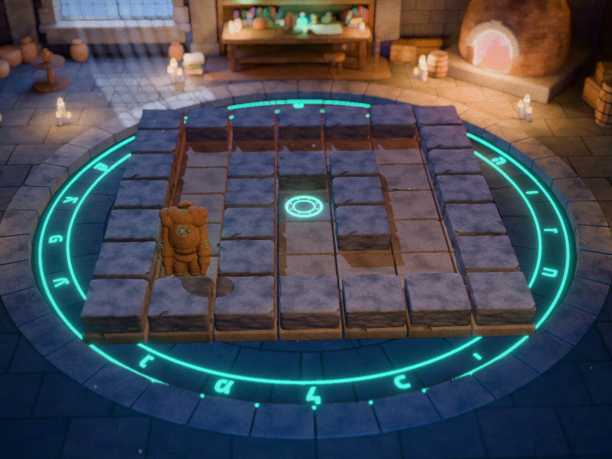

<h1 align="center">הגולם</h1>

<p align="center">
  <b>עושה בדיוק, אבל בדיוק, מה שאמרת.</b><br>
  <i>The Too-Literal Golem: he does exactly, but exactly, what you said.</i>
</p>

<p align="center">
  
</p>

<p align="center">
  A 3D browser game that teaches kids to think like programmers.<br>
  Ages 8–11 · Hebrew · five minutes a day · five days
</p>

---

## The idea

The Master built a golem out of clay. He is very strong, and very obedient. Too obedient.

Tell him to walk and he walks: into the wall, off the edge, straight into the cat. Nobody said stop. You lay out instruction stones, press **!החייה**, and watch him carry them out to the letter. When it goes wrong, it is never the golem's fault. That is the whole lesson.

One job unlocks per day. Each one quietly introduces a real programming idea:

| Day | Job | What it teaches |
| :-: | --- | --- |
| א׳ | **אור ראשון** · walk to the candle | Sequencing: one step after another |
| ב׳ | **הצמח הצמא** · carry the jug to the plant (not the cat) | Precision, and debugging what you actually said |
| ג׳ | **המסדרון הארוך** · a long corridor, too few stones | Loops |
| ד׳ | **שלוש אותיות** · collect three letters | Spotting the pattern inside a loop |
| ה׳ | **המבוך** · a maze he cannot see across | Conditions: *is there a wall?* |

<p align="center">
  
  
  
</p>

Collect the three letters and they spell the word on his forehead: **אמת**.

## Run it

```bash
npm install
npm run dev
```

Open the address Vite prints. Add `?dev=1` to unlock all five days and get a **פתרון** button that fills in the answer; `?dev=0` puts the daily lock back.

## ElevenLabs API key

Every sound in the game was generated with [ElevenLabs](https://elevenlabs.io): the Master's voice, the music, and the effects. The finished files live in `public/audio`, so **the game runs without a key**.

You only need one to change or regenerate audio. Put it in a `.env` file in the project root:

```
ELEVENLABS_API_KEY=your_key_here
```

```bash
npm run audio                                      # generate anything missing
node tools/gen-audio.mjs --force --only vo_intro   # redo a single clip
```

Lines, prompts and the voice are defined in `tools/audio-spec.mjs`. `.env` is git-ignored. Keep it that way.

## How it was made

- **Models:** the golem, the props and the workshop are sculpted by Python scripts in `blender/`, with the room's lighting ray-traced in Cycles and baked into textures. The exports are in `public/models`; run `npm run assets` only if you want to rebuild them (needs Blender).
- **Rendering:** [three.js](https://threejs.org) with depth of field, bloom, film grain, moonlight shafts and drifting dust.
- **Game logic:** a tiny interpreter in `src/interp.js` turns the stones into a list of events, and the world plays them back.
- **Audio:** ElevenLabs for voice, music and effects, mixed live in the browser.

Built in a day, as an experiment.
